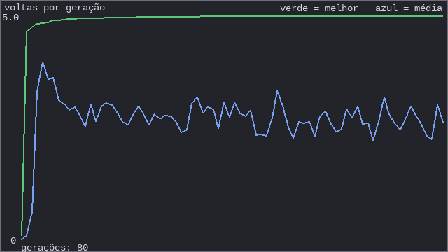

# A teoria por trás dos carros que aprendem a dirigir

Este guia explica **por que** o `03_evolucao.py` funciona. Leia junto com o código: cada seção aponta onde a ideia aparece nele.

Para apenas rodar o projeto, veja o [README](README.md).

O projeto é uma versão didática do vídeo [Deep Cars (Universo Programado)](https://www.youtube.com/watch?v=gnfkfUQvKDw). O código original está em [JVictorDias/DeepCars](https://github.com/JVictorDias/DeepCars). Esta versão usa Python, 100 carros e uma rede menor.

---

## 1. O mapa dos termos

```
Inteligência Artificial   (qualquer sistema que toma decisões "inteligentes")
 └─ Machine Learning      (o sistema aprende a partir de dados ou tentativas)
     └─ Redes neurais     (um tipo de ML, inspirado em neurônios)
         └─ Deep Learning (redes com várias camadas)
```

O vídeo usa uma **rede neural pequena**, treinada por **evolução**. Isso é ML. É chamado de "Deep" no título mais por marketing do que por tecnicismo, porque a rede tem só uma camada escondida.

Há três grandes jeitos de uma máquina aprender:

| Jeito | Como aprende | Exemplo |
|---|---|---|
| **Supervisionado** | Vê exemplos com a resposta certa | Classificar fotos de gato e cachorro |
| **Por reforço** | Age, recebe recompensa ou punição e ajusta | Robô que aprende a andar |
| **Evolutivo** (o nosso) | Muitos candidatos competem e os melhores se reproduzem | Os carros deste projeto |

---

## 2. O neurônio (`01_neuronio.py`)

Um neurônio artificial faz três coisas:

1. Multiplica cada entrada pelo seu **peso**.
2. Soma tudo, mais o **viés**.
3. Passa o resultado por uma **função de ativação**.

```
saída = ativação( entrada1·peso1 + entrada2·peso2 + ... + viés )
```

- **Peso:** diz o quanto aquela entrada importa. Um peso negativo faz a entrada "empurrar para o outro lado".
- **Viés:** um empurrãozinho fixo, independente das entradas. Equivale a uma entrada que vale sempre 1.
- **Ativação:** sem ela, empilhar neurônios seria o mesmo que ter um só (só contas lineares). A ativação cria o comportamento não linear que permite à rede aprender coisas complexas.

A **ReLU** (`max(0, x)`) é simples: negativo vira zero, positivo passa igual.
A **tanh** deixa a saída entre -1 e 1. Usamos na saída porque o volante vai de "todo para a esquerda" a "todo para a direita".

---

## 3. A rede (`02_rede.py`)

Vários neurônios, em camadas, formam a rede:

```
 7 sensores + viés      6 neurônios + viés       1 saída
  ┌───┐                    ┌───┐
  │ s1│──────────────────▶│ h1│───┐
  │ s2│──┐                 ├───┤   │         ┌────────┐
  │ ..│  ├──(todos ligam   │ h2│───┼───────▶│ volante│
  │ s7│──┘   em todos)     │ ..│   │         └────────┘
  │ 1 │                    │ h6│───┘
  └───┘                    └───┘
 CAMADA DE ENTRADA     CAMADA ESCONDIDA        SAÍDA
```

- **Entrada:** a leitura de 7 sensores (distância até a parede, de 0 a 1) e o viés.
- **Escondida:** "esconde" porque você não vê o que ela representa. É onde a rede combina os sensores em ideias do tipo "estou entrando em curva fechada para a esquerda".
- **Saída:** o volante, de -1 a 1.

### Quantos números a rede guarda?

Cada ligação tem um peso:

- Entrada para escondida: (7 sensores + 1 viés) × 6 neurônios = 48
- Escondida para saída: (6 neurônios + 1 viés) × 1 saída = 7
- **Total: 55 pesos.**

> **Ideia central:** tudo o que o carro "sabe" cabe nessa lista de 55 números. Dirigir bem ou mal depende só deles. Aprender significa **encontrar bons valores para essa lista**.

Essa lista é chamada de **genoma** no código, porque é ela que passa de pai para filho.

### Como o carro decide (propagação para frente)

Em cada quadro da simulação (`Carro.atualizar`):

1. Cada sensor lança um raio a partir de um ponto da carroceria (quinas, para-choque, laterais) e mede a distância até a parede.
2. Essas 7 leituras entram na rede (`rede.pensar`).
3. A rede devolve um valor de volante entre -1 e 1.
4. O carro vira o ângulo proporcionalmente e anda 4 pixels.

Os pesos **não mudam** durante a vida do carro. Cada carro nasce com um cérebro fixo e vive com ele. O aprendizado acontece **entre gerações**, não dentro delas. Esta é a diferença para o "aprender" do dia a dia.

---

## 4. A evolução (`03_evolucao.py`)

A ideia vem da seleção natural de Darwin. Quatro ingredientes:

| Ingrediente | O que é | No código |
|---|---|---|
| **População** | Muitos indivíduos diferentes ao mesmo tempo | `POPULACAO = 100` carros |
| **Fitness** | Uma nota que mede o quão bem cada um foi | `progresso`: quanto avançou em volta da pista |
| **Seleção** | Os melhores têm mais chance de deixar descendentes | `QTD_ELITE = 10` sobrevivem |
| **Mutação** | Cópias com pequenas alterações aleatórias | `mutar()` |

### O ciclo de cada geração

```
 ┌──────────────────────────────────────────────────────────┐
 │ 1. Geração 1: 100 cérebros com pesos ALEATÓRIOS          │
 │ 2. Todos correm ao mesmo tempo até bater ou o tempo      │
 │    acabar                                                │
 │ 3. Cada carro recebe uma nota (quanto avançou)           │
 │ 4. Ordena e guarda os 10 melhores (elite)                │
 │ 5. Nova geração = os 10 + 90 cópias mutadas dos 10       │
 └──────────────┬───────────────────────────────────────────┘
                └──────────▶ volta ao passo 2
```

### A mutação em detalhe

```python
for peso in genoma:
    if random.random() < CHANCE_MUTACAO:     # 15% de chance por peso
        peso += random.gauss(0, FORCA_MUTACAO)  # soma um valor pequeno
```

Dos 55 pesos, uns 8 mudam um pouco em cada filho. A maioria das mutações piora ou não muda nada. Mas **entre 90 filhos, alguns melhoram por sorte**, e esses ganham a vez na geração seguinte.

### Por que isso funciona?

Imagine uma paisagem com montanhas, onde a altura é a nota (fitness) e cada posição é uma lista de 55 pesos:

- Gerar pesos aleatórios joga os carros em pontos aleatórios, quase todos num vale (batem logo).
- Os mutantes dão passinhos para os lados. Quem sobe um pouco é selecionado.
- Repetindo, a população **escala a montanha**.

Isso se chama **busca em paisagem de otimização** (_hill climbing_ com população). Nenhum carro entende nada de pista. A melhora vem só de "tentar variações e guardar o que deu certo".

### O que o código **não** faz (e o vídeo também não)

- **Cruzamento (_crossover_):** algoritmos genéticos completos misturam pedaços de dois pais. Aqui só há mutação ("Random Mutations", como diz a descrição do vídeo).
- **Retropropagação (_backpropagation_):** o método de quase toda IA moderna. Ele calcula a direção exata para ajustar cada peso, o que exige saber a resposta certa. A evolução não precisa disso, só da nota final. Por isso serve quando não existe "resposta certa" por quadro.

---

## 5. Os parâmetros e o que cada um controla

Os de evolução ficam no começo de `03_evolucao.py`; os do carro (velocidade, sensores) em `carro.py`; os da pista em `pista.py`. Mexa em **um por vez** e observe.

| Parâmetro | Efeito esperado | Experimento |
|---|---|---|
| `POPULACAO` | Mais carros dão mais chances de achar uma boa mutação, mas deixam a simulação mais lenta | 20 contra 300 |
| `QTD_ELITE` | Poucos pais evoluem rápido, mas perdem diversidade e podem travar | 1, 10, 50 |
| `CHANCE_MUTACAO` | Com 0 não há evolução. Muito alta destrói o que já funcionava | 0, 0.15, 0.8 |
| `FORCA_MUTACAO` | Passos pequenos refinam. Passos grandes exploram, mas erram | 0.05, 0.3, 1.5 |
| Pista (em `pista.py`): ondulação, curvas, largura | Pista mais difícil exige mais gerações | Treinar com `--pistas dificil` |
| `ANGULOS_SENSORES` (em `carro.py`) | Mais sensores dão mais informação, mas aumentam a rede | Tirar os de ±90° |

> **Nota:** a rede muda de tamanho se você alterar o número de sensores. `N_SENSORES` em `02_rede.py` precisa acompanhar a lista `ANGULOS_SENSORES` em `carro.py`. Mude os dois juntos (o código avisa se estiverem diferentes).

---

## 6. Por que a pista tem ondulações?

Na primeira versão a pista era um círculo perfeito. Resultado: já na geração 1, alguns carros completavam a pista **sem usar os sensores**. Bastava virar o volante um pouco para o mesmo lado, sempre, e o carro dava voltas.

Isso mostra um ponto importante: **o fitness define o que a evolução procura, não o que você tinha em mente.** Se existe um atalho bobo, a evolução acha. A pista ondulada obriga o carro a reagir ao que vê.

---

## 7. Mapa de experimentos

Esta é a parte de "o que fazer a seguir". Está ordenada do mais simples ao mais ambicioso.

**Estado atual:** A, B, C e E já estão no código. Os demais são ideias.

### A. Salvar e carregar os vencedores (implementado)
**O que é:** gravar em arquivo (JSON) o genoma dos melhores carros ao final de cada geração (ou do recorde geral) e poder carregá-los depois.
**O que você aprende:** o conhecimento da rede é só uma lista de números, que cabe num arquivo de poucas linhas.
**Esforço:** pequeno.
**Onde:** `genoma_io.py`. O `03_evolucao.py` grava `resultados/campeao.json` sempre que bate o recorde.

### B. Testar os vencedores em outra pista (generalização) (implementado)
**O que é:** treinar em uma pista, salvar o campeão e colocá-lo numa pista nova que ele nunca viu: outro número de curvas, outra largura, um formato diferente.
**A pergunta:** o carro aprendeu **a dirigir** ou só **a decorar aquela pista**?
**O que você aprende:**
- **Generalização:** funcionar em situações novas é o objetivo real de todo ML.
- **Overfitting (sobreajuste):** quando o modelo vai muito bem no treino e mal no teste.
- A diferença entre **treino** e **teste**, conceito central em ML.

**Hipótese para testar:** como o carro só enxerga os sensores (não "sabe" a forma da pista), ele pode generalizar razoavelmente para curvas parecidas, mas falhar em curvas bem mais fechadas do que as que viu.
**Esforço:** pequeno a médio.
**Onde:** `04_teste_em_outra_pista.py`, com as pistas extras em `pista.py`.

**Resultado de um treino real** (80 gerações na pista `treino`, campeão em `exemplos/campeao_exemplo.json`):

| Pista | Campeão | Cérebros aleatórios que aguentaram (de 100) |
|---|---|---|
| treino | completou, 4,96 voltas | 2 |
| suave | bateu no quadro 106 | 2 |
| muitas_curvas | bateu no quadro 55 | 1 |
| estreita | bateu no quadro 18 | 0 |
| dificil | bateu no quadro 39 | 0 |

Este campeão dirige bem só na pista em que treinou e bate em todas as outras, até na `suave`, que é parecida: é **overfitting**. A nota dele (voltas na pista de treino) era ótima, mas ela só media o desempenho naquela pista.

Dois cuidados ao ler isso:
- **O resultado varia de treino para treino.** Em um treino mais curto (15 gerações), o campeão passou na `suave` e na `muitas_curvas`. Uma execução só não prova nada, e repetir com sementes diferentes seria o próximo passo para uma conclusão sólida.
- **A comparação com cérebros aleatórios tem ruído.** Com sorte, 2 a 4 cérebros aleatórios em 100 aguentam uma pista fácil. Por isso a tabela conta quantos aguentam, e não só o melhor.

Nesta curva (`exemplos/curva_aprendizado.png`), o melhor carro chega perto do teto já na geração 11 e depois quase não muda, enquanto a média oscila por causa das mutações. Mais gerações não resolvem o overfitting: o que falta é variedade nos dados de treino (experimento C).



### C. Treinar em várias pistas ao mesmo tempo (implementado)
**O que é:** em vez de uma pista, avaliar cada carro em 2 ou 3 pistas e usar a média como nota.
**A pergunta:** isso melhora a generalização do experimento B?
**O que você aprende:** como a variedade nos dados de treino combate o overfitting.
**Esforço:** médio.
**Onde:** `03_evolucao.py --pistas treino,suave,muitas_curvas`. Cada cérebro corre em todas as pistas ao mesmo tempo, e a nota é a média das voltas.

**Resultado** (40 gerações, campeão em `exemplos/campeao_multipista.json`, com `estreita` e `dificil` deixadas de fora do treino):

| Pista | Campeão de várias pistas | Campeão de uma pista só |
|---|---|---|
| treino | completou, 4,90 voltas | completou, 4,96 voltas |
| suave | completou, 5,67 voltas | bateu no quadro 106 |
| muitas_curvas | completou, 5,28 voltas | bateu no quadro 55 |
| estreita (inédita) | bateu no quadro 16 | bateu no quadro 18 |
| dificil (inédita) | bateu no quadro 46 | bateu no quadro 39 |

O que isso mostra e o que **não** mostra:
- **Mostra:** treinar em várias pistas produz um cérebro que dirige em todas elas. O de uma pista só decorou a sua.
- **Não mostra** que ele generalizou para pistas novas: nas duas inéditas ele bate logo, como o outro. Mas `estreita` e `dificil` são mais apertadas e curvas mais fortes do que qualquer pista do treino, então pode ser pedir demais. Também não verifiquei se um carro desse tamanho consegue dirigir nelas. Um teste mais justo seria deixar de fora uma pista de dificuldade parecida com as do treino.
- **Armadilha da média:** na geração 1 o melhor cérebro tinha 5,19 voltas na `suave` e 0,15 na `treino`. A média premia esse "especialista", e só com as gerações ele perde para quem anda bem em todas. Se a nota fosse o **pior** resultado entre as pistas, esse atalho não existiria.

**Teste mais justo:** treinar só em `treino` e `muitas_curvas` (40 gerações) e testar na `suave`, uma pista de dificuldade parecida que ficou de fora.

| Pista | Campeão |
|---|---|
| treino (usada no treino) | completou, 4,90 voltas |
| muitas_curvas (usada no treino) | completou, 5,31 voltas |
| **suave (inédita)** | **bateu no quadro 112, 0,33 volta** |
| estreita (inédita) | bateu no quadro 279, 0,72 volta |
| dificil (inédita) | bateu no quadro 45, 0,09 volta |

Este cérebro **não generalizou**: dirige bem nas pistas do treino e bate cedo numa pista parecida que nunca viu. É overfitting, agora medido com um teste justo.

Ressalvas: é uma única execução, e o resultado depende da sorte de cada treino (o campeão de 15 gerações do início passou na `suave`). Para uma conclusão sólida, repita o treino várias vezes e conte quantas vezes o campeão passa na pista inédita. Uma hipótese para o fracasso: a rede decide só pelos 7 sensores e pode ter decorado a sequência fixa de curvas das pistas de treino, em vez de aprender a seguir a parede. Isso leva ao experimento D.

### D. Pistas aleatórias a cada geração (implementado)
**O que é:** a cada geração, sortear pistas novas (`--aleatorias 2`). Os cérebros nunca veem a mesma pista duas vezes, então não dá para decorar o traçado.
**O que você aprende:** treinar com dados variáveis, e a diferença entre treino e **validação**.

**Primeira tentativa: fracasso instrutivo.** O campeão era "o melhor da última geração", escolhido em apenas 2 pistas. Ele completou só 3 de 20 pistas sorteadas novas e bateu cedo em todas as fixas. Foi a *maldição do vencedor*: entre 100 mutantes, o melhor em 2 pistas costuma ser o que teve sorte nelas.

**Correção: conjunto de validação.** No fim do treino, os 10 melhores cérebros (a elite) correm em 12 pistas novas, e o campeão é o que for melhor nelas. É a mesma ideia de separar dados de treino e de validação em ML.

**Resultado (60 gerações, uma execução):** o campeão completou 12 de 12 pistas de validação e, no teste independente nas 5 pistas fixas, **completou todas**:

| pista | campeão | aleatórios que aguentaram (de 100) |
|---|---|---|
| treino | 4,81 voltas | 2 |
| suave | 5,61 voltas | 2 |
| muitas_curvas | 5,23 voltas | 1 |
| estreita | 4,63 voltas | 0 |
| dificil | 4,71 voltas | 0 |

Isso inclui `estreita` e `dificil`, onde os campeões anteriores batiam em poucos quadros. Também mostra que essas pistas são dirigíveis. O campeão está em `exemplos/campeao_aleatorias.json`.

**Repetindo o treino 5 vezes (a ressalva se confirmou).** O resultado acima foi, em boa parte, sorte. Cinco treinos novos, com a mesma configuração, deram:

| treino | treino | suave | muitas_curvas | estreita | dificil | fixas completas | validação |
|---|---|---|---|---|---|---|---|
| 1 | OK | OK | OK | bateu | bateu | 3/5 | 12/12 |
| 2 | OK | OK | OK | bateu | bateu | 3/5 | 10/12 |
| 3 | bateu | OK | OK | bateu | bateu | 2/5 | 6/12 |
| 4 | bateu | bateu | OK | bateu | bateu | 1/5 | 8/12 |
| 5 | OK | OK | OK | bateu | bateu | 3/5 | 7/12 |

O que isso mostra:
- Pistas parecidas com as sorteadas (`muitas_curvas` em 5 de 5, `suave` e `treino` em 3 a 4 de 5) são bem generalizadas.
- `estreita` e `dificil` não foram completadas em nenhum dos 5 treinos. O campeão que passou em tudo foi um caso raro entre 6 treinos.
- A nota na validação ajuda um pouco, mas não prevê o resultado: o treino 5 (7/12) empatou com o treino 1 (12/12) nas pistas fixas.
- Lição de método: **uma única execução não prova nada**. Em ML, repete-se o experimento e se reporta a variação, não o melhor caso.

**Testando a hipótese da largura.** As pistas sorteadas tinham largura de 60 a 95, e a `estreita` tem 50, fora do que o treino cobria. Repeti os 5 treinos com `--largura-min 45` (larguras de 45 a 95):

| treino | treino | suave | muitas_curvas | estreita | dificil | fixas completas | validação |
|---|---|---|---|---|---|---|---|
| 1 | OK | OK | OK | OK | bateu | 4/5 | 12/12 |
| 2 | OK | OK | bateu | bateu | bateu | 2/5 | 11/12 |
| 3 | OK | OK | bateu | bateu | bateu | 2/5 | 8/12 |
| 4 | OK | OK | OK | OK | bateu | 4/5 | 12/12 |
| 5 | OK | bateu | OK | OK | bateu | 3/5 | 9/12 |

- A `estreita` passou de **0 de 5** para **3 de 5** treinos. A hipótese se confirma: o que o carro vê no treino define até onde ele generaliza.
- A `dificil` continua em 0 de 5. Outra causa provável: ela tem ondulação 50 com 5 curvas, mas o sorteio limita a ondulação a `200 / curvas` = 40. Ela também está fora da faixa treinada (hipótese ainda não testada).
- Total de pistas fixas completadas: 15 de 25, contra 12 de 25 antes. A diferença é pequena e com 5 amostras não é conclusiva. O ganho claro está na `estreita`.
- Lição: **cobrir a variação do mundo real nos dados de treino** importa mais do que treinar por mais tempo.

### H. Circuitos de autódromo (implementado)
**O que é:** em vez de anéis ondulados, o traçado é uma curva fechada qualquer, com chicanes, curvas fechadas e trechos mais retos (`circuito.py`).
**Como é feito:** sorteiam-se de 8 a 14 pontos de controle e uma curva suave passa por eles. Onde a curva faz uma dobra mais fechada do que o carro consegue (o carro anda a 4 px por quadro e vira no máximo 0,08 rad, então o menor raio é 50 px), ela é aberta. As curvas que já eram possíveis ficam como estão, então sobram curvas no limite do carro. A versão `--dificeis` tem mais pontos de controle, raio mínimo 56 e asfalto de 46 a 64 px.
**O que muda no código:** o carro só pergunta à pista "onde estou ao longo do traçado?" (`fase`), em vez de calcular o ângulo em volta do centro. Assim o mesmo carro e o mesmo treino servem para anéis e circuitos.

**Resultado (uma execução de cada treino, 60 gerações, validação em 12 pistas novas):**

| campeão treinado em | anéis fixos | 5 autódromos | 5 autódromos difíceis |
|---|---|---|---|
| anéis aleatórios (`exemplos/campeao_aleatorias.json`) | 5/5 | 4/5 | **0/5** |
| autódromos normais | 1/5 | 5/5 | 5/5 |
| autódromos difíceis | 2/5 | 5/5 | 5/5 |

- A transferência **não é simétrica**. O campeão treinado em anéis dirige quase todos os autódromos normais, mas não os difíceis. Os campeões treinados em autódromos dirigem todos os autódromos, mas falham em boa parte dos anéis.
- Os autódromos difíceis ainda não são difíceis para quem treinou neles (5/5). O que limita a dificuldade hoje é a velocidade fixa: o carro só controla o volante.
**Repetindo 5 vezes o treino nos autódromos difíceis:**

| treino | validação | anéis fixos | 5 autódromos | 5 difíceis |
|---|---|---|---|---|
| 1 | 12/12 | 4/5 | 5/5 | 5/5 |
| 2 | 11/12 | 2/5 | 5/5 | 5/5 |
| 3 | 10/12 | 1/5 | 5/5 | 5/5 |
| 4 | 12/12 | 1/5 | 5/5 | 5/5 |
| 5 | 12/12 | 1/5 | 5/5 | 5/5 |

- Nos circuitos, o resultado se **repete**: os 5 treinos completaram os 10 circuitos fixos (os 5 normais e os 5 difíceis). Diferente dos anéis, aqui o resultado não depende da sorte do treino.
- Nos anéis a variação é grande (1 a 4 em 5). A assimetria é real, mas a causa não foi investigada. Quase todos os fracassos em anéis são batidas logo no começo (cerca de 0,2 volta).
- Os circuitos difíceis são difíceis para um cérebro sem treino (0 de 500 completaram), mas não para quem treinou neles. Para dificultar de verdade falta controlar a velocidade (freio e acelerador).

### E. Gráfico de aprendizado (implementado)
**O que é:** guardar o melhor fitness de cada geração e plotar uma curva.
**O que você aprende:** a forma típica do aprendizado, com subida rápida no começo e depois um platô. Também permite comparar parâmetros com mais clareza do que "olhando a tela".
**Esforço:** pequeno.
**Onde:** `grafico.py`. O gráfico aparece na janela e, ao sair, é salvo em `resultados/curva_aprendizado.png` junto com `resultados/historico.csv`.

### F. Visualizar o cérebro
**O que é:** desenhar a rede na tela com os pesos coloridos (positivo em azul, negativo em vermelho) e a ativação de cada neurônio em tempo real.
**O que você aprende:** o que significa "o cérebro decide". Dá para ver qual sensor mais afeta o volante.
**Esforço:** médio.

### G. Comparar evolução com outro método
**O que é:** resolver o mesmo problema por aprendizado por reforço (biblioteca como `stable-baselines3`) e comparar o tempo e o resultado.
**O que você aprende:** os trade-offs entre os dois métodos. O reforço costuma ser mais eficiente em amostras, mas bem mais pesado de configurar.
**Esforço:** grande (e pesado para o seu i5 sem GPU).

### Ordem sugerida

```
A (salvar)  ──▶  E (gráfico)  ──▶  B (outra pista)  ──▶  C ou D  ──▶  F
   rápido          rápido          o mais didático       generalização   intuição
```

O experimento **B** é o que mais ensina, porque ele mostra a diferença entre "parece que aprendeu" e "aprendeu de fato".

---

## 8. Glossário

| Termo | Significado |
|---|---|
| **Peso** | Número que mede a importância de uma entrada para um neurônio. É o que a rede aprende |
| **Viés (_bias_)** | Empurrão fixo somado no neurônio |
| **Ativação** | Função aplicada à soma (ReLU, tanh). Dá à rede capacidade não linear |
| **Genoma** | A lista de pesos de um indivíduo |
| **Fitness** | A nota que mede o desempenho |
| **Geração** | Uma rodada completa: todos correm, seleciona, reproduz |
| **Elite** | Os melhores, que passam para a próxima geração sem alteração |
| **Mutação** | Pequena alteração aleatória nos pesos |
| **Generalização** | Funcionar em situações nunca vistas no treino |
| **Overfitting** | "Decorar" o treino e falhar em situações novas |
| **Hiperparâmetro** | Configuração que você escolhe (população, taxa de mutação), diferente dos pesos que a rede aprende |

---

## 9. Para ir além

- Vídeo original: <https://www.youtube.com/watch?v=gnfkfUQvKDw>
- Código original (C): <https://github.com/JVictorDias/DeepCars>
- Busque por: _neuroevolution_, _NEAT_ (que evolui também a estrutura da rede), _genetic algorithm_, _hill climbing_.
